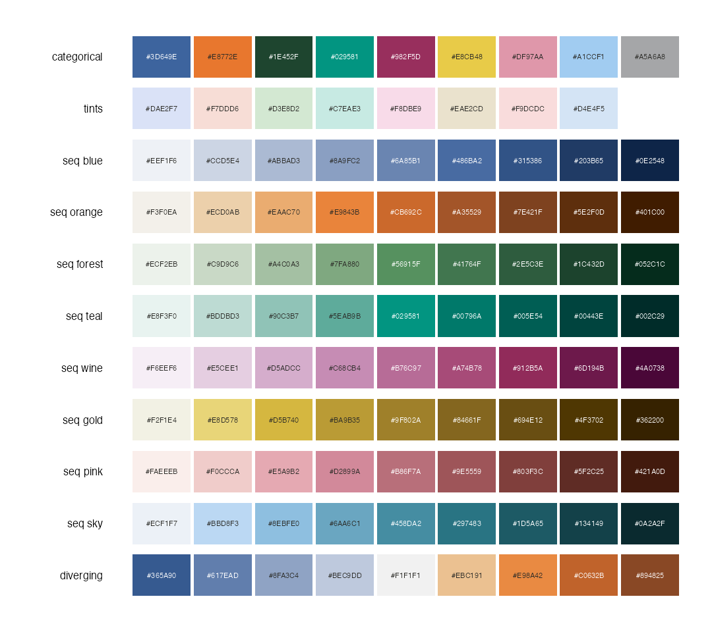
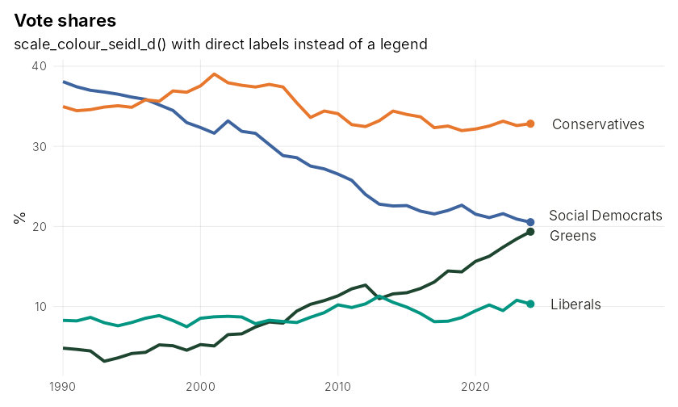
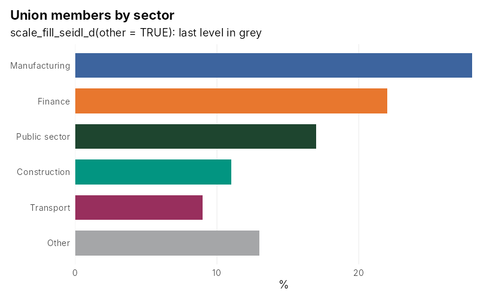
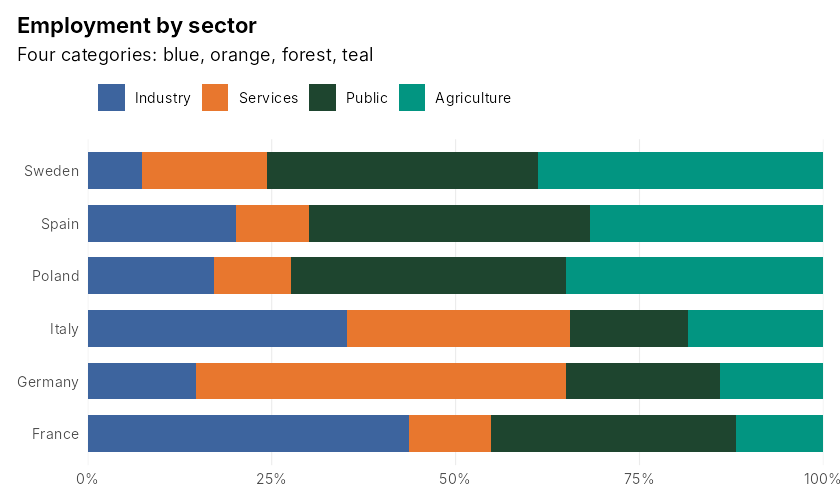
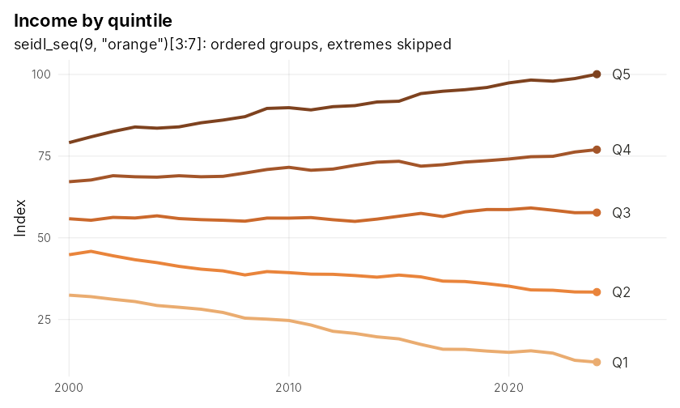
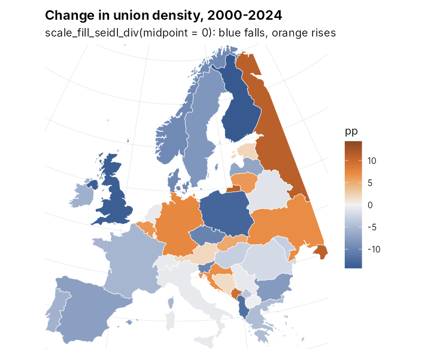
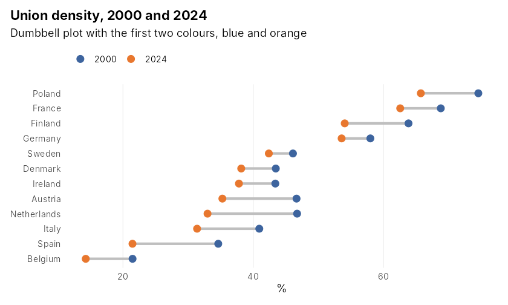

# seidlpal

Colour-blind-safe palettes and ggplot2 scales: an eight-colour categorical
palette, matching sequential and diverging scales, light tints for diagram
fills, and exports for SCSS and draw.io.



## Install

```r
pak::pak("tseidl/seidlpal")
```

## Use

```r
library(seidlpal)
library(ggplot2)

# categorical (first colours first: blue, orange, forest, teal, wine, ...)
ggplot(mpg, aes(displ, hwy, colour = drv)) + geom_point() + scale_colour_seidl_d()
scale_fill_seidl_d(other = TRUE)      # last level in grey, for "other" (up to 7 levels)

# sequential: one ramp per colour, blue (default), orange, forest, teal,
# wine, gold, pink, sky. Low = light, high = dark
scale_fill_seidl_c()                  # continuous
scale_fill_seidl_b("orange")          # binned, e.g. maps

# diverging: blue - neutral - orange
scale_fill_seidl_div(midpoint = 0)

# raw colours
seidl_colours; seidl_grey; seidl_tints
seidl_pal(3); seidl_seq(9, "teal"); seidl_div(7)
seidl_show()                          # swatches of everything
```

For ordered groups drawn as bars or lines, skip the extremes of a sequential
ramp, e.g. `seidl_seq(9)[3:7]`.

## Gallery

Typical uses. Code: `data-raw/gallery.R`.

| | |
|---|---|
|  |  |
| Direct labels instead of a legend | `other = TRUE` puts the last level in grey |
|  |  |
| The first four colours | Ordered groups from a ramp, extremes skipped |
|  |  |
| Diverging scale for change, midpoint at 0 | Dumbbell with the first two colours |

## Exports

`inst/exports/` holds the same colours for other tools, generated by
`data-raw/exports.R` (re-run after changing colours):

- `seidlpal.scss`: SCSS variables (`$seidl-blue`, `$seidl-blue-tint`,
  `$seidl-seq-blue-1`, ...).
- `drawio-config.json`: in draw.io, *Extras > Configuration*, paste, *Apply*,
  reload. Adds the colours to the colour picker and tint-fill/colour-border
  style presets to the Format panel.
- `seidlpal-colours.csv`: every colour with set and name.

## Design notes

- **Structure.** Blue shares the hue of the house navy `#072140`. Blue, forest
  and wine are the dark anchors, orange the one clear warm colour, gold, pink
  and sky the light accents. The colours relate to the linocut illustrations
  (navy, terracotta, ochre, forest) as clearer versions of the same families.
- **Colour-blind checks.** Every pair of the eight colours was compared under
  simulated deuteranopia, protanopia and tritanopia (colorspace, full severity).
  The closest pair stays at a CIEDE2000 difference of about 12.7 for all eight
  colours, 16 for the first three. Okabe-Ito scores 11.1 on the same measure.
- **Order matters.** Most charts use only the first colours. Gold, pink and sky
  come late because they have little contrast against light backgrounds and are
  too faint for thin lines.
- **Eight colours at most.** Beyond that, lump the rest into "other"
  (`seidl_grey`), label lines directly, or use facets. The grey is light and
  stays distinct from the first six colours; it is close to pink, so use it
  with at most six colours.
- **Shared lightness steps.** The sequential ramps use the same steps, so step k
  of blue is as dark as step k of orange. The diverging ramp joins the blue and
  orange ramps at a neutral centre.
- **Ramp shapes.** Every ramp passes through its palette colour. Gold turns
  bronze rather than olive in its dark half; sky turns petrol (toward cyan) to
  keep away from blue; forest turns yellow-green in its light half to keep away
  from teal; wine turns aubergine and lilac, pink brick red and peach, to keep
  the two apart. In normal vision forest and teal are the closest pair of ramps.
- **Ramps that look alike under colour blindness.** Comparing matching steps
  under simulated deuteranopia and protanopia, these pairs come close: orange
  and gold, forest and pink, teal and wine, blue and wine, wine and sky, blue
  and sky, and, a little less, teal and pink. Don't use them as contrasting
  scales side by side. Blue with orange or gold stays far apart under every
  simulation.
